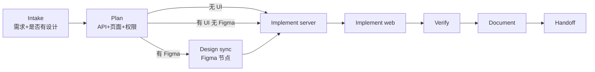

# 功能开发流程（含 Figma）

在标准六阶段之上，说明**日常功能怎么做**，以及**有 UI / Figma 时插在哪一步**。

总流程仍是：

```text
Intake → Plan → Implement → Verify → Document → Handoff
```

有 Figma 时，在 **Intake / Plan** 锁定设计源，在 **Implement（web）** 用 Figma MCP 取上下文，在 **Verify** 对照截图验收。

> **设计稿怎么画（B/C 端最优方式）**见独立文档：[../design/figma-b-c-from-requirements.md](../design/figma-b-c-from-requirements.md)。本文只覆盖「稿 → 代码」对接。



---

## 1. 标准功能开发（无设计稿也可）

| 阶段 | 你做什么 | AI / 开发做什么 | 出口 |
|------|----------|-----------------|------|
| **Intake** | 说清场景、租户、角色、成功标准 | 追问缺口，产出 Problem 模板 | 范围可测 |
| **Plan** | 确认方案与切片 | 列 server/web 影响、权限码、迁移、风险 | 任务列表可执行 |
| **Implement** | 按需确认接口字段 | 默认 **先 API 契约再 UI**；platform vs apps 分包 | 代码可运行 |
| **Verify** | 抽测主路径 | 构建 + 租户隔离 + 权限拒绝 | 有证据 |
| **Document** | — | 回写 module-map / 约定 | docs 同步 |
| **Handoff** | 验收 | 交付摘要 + Follow-ups | 可交接 |

启动话术：

```text
按 docs/ai-workflow 执行：<功能>
范围：server + web
应用：platform | apps/<code>
租户/权限：…
成功标准：…
```

提示词模板：[prompts/feature.md](./prompts/feature.md)

---

## 2. 何时必须拉 Figma

| 情况 | 是否走 Figma |
|------|----------------|
| 纯 API / 脚本 / 迁移 | 否 |
| 沿用现有后台页样式的小改（加列、加筛选项） | 通常否；有稿则更好 |
| 新页面、新布局、新表单结构、明确视觉规范 | **是** |
| 设计未定、只有文字需求 | Intake 先标「设计待定」；可先 API，UI 等链接 |

---

## 3. Figma 如何挂进各阶段

### ① Intake

在问题清单中增加：

7. **UI**：有无 Figma？链接指向**具体 Frame/图层**（不要只给文件首页）  
8. **设计状态**：终稿 / 评审中 / 仅参考（影响是否 1:1）

输出模板追加：

```markdown
## UI / Design
- Figma: <url 含 node-id>
- 状态: final | draft | reference-only
- 涉及页面: …
```

### ② Plan

- 拆任务时单独列出：**Design sync**（取设计上下文）→ **Web 按稿实现**。
- 标明组件复用：优先 antd / ProComponents / 现有 `shared/ui`，**禁止**把 Figma MCP 吐出的 Tailwind 样例当最终风格（本项目是方案 A：antd）。
- 设计与 API 字段不一致时：Plan 里写清以谁为准，或提设计/产品确认。

### ③ Implement（有 Figma 时的 web 顺序）

在写页面代码前，按 Figma MCP 固定顺序（不可跳过）：

1. `get_design_context`（精确 node）  
2. 过大则先 `get_metadata` 再按需取 context  
3. `get_screenshot` 作为视觉对照  
4. 下载资源（若 MCP 给了 localhost 资源地址，**直接用**，勿换占位图）  
5. **翻译**进本仓库约定：React + antd/ProComponents + 现有布局，而不是照搬 MCP 默认栈  
6. 与截图核对后再进入联调

与后端的节奏建议：

```text
契约/DTO 对齐 →（可选先 mock）→ Figma sync → 页面实现 → 接真 API
```

若 API 未就绪：可用前端 mock / MSW / 临时 stub，但 Plan 中要写清替换点。

### ④ Verify（有 UI 时追加）

- [ ] 对照 Figma 截图：布局、主按钮、空态/错误态（稿中有的）  
- [ ] 响应式若稿有多断点则抽测  
- [ ] 仍执行原有租户 / 权限 / 构建检查：[04-verify.md](./04-verify.md)

### ⑤ Document

- 新页面：更新 [../web/module-map.md](../web/module-map.md)  
- 若形成可复用布局/组件约定：补 [../web/conventions.md](../web/conventions.md)  
- 可选：在 Handoff 附 Figma 链接 + 实现节点说明

---

## 4. 给 AI 的 Figma 话术

```text
按 docs/ai-workflow 与 docs/ai-workflow/feature-dev-with-figma.md 执行。

## 需求
<功能简述>

## Figma
<link 到具体 Frame，含 node-id>
设计状态: final

## 范围
server + web；应用 apps/<code> 或 platform

## 要求
1. Intake/Plan 先对齐 API 与权限
2. Web 实现前必须 get_design_context + get_screenshot
3. UI 落到 antd/ProComponents，复用现有壳与 shared
4. Verify 含设计对照 + 租户/权限
5. 回写 docs 后 Handoff
```

更短的专用模板：[prompts/feature-figma.md](./prompts/feature-figma.md)

---

## 5. 角色分工（有设计时）

| 角色 | 额外动作 |
|------|----------|
| Analyst | 要到 Figma 深链与设计状态 |
| Architect | 标清「设计 1:1」vs「设计系统优先」冲突处理 |
| Executor | 先 Figma MCP，再按仓库栈实现 |
| Verifier | 截图 Diff / 目视对照 + 原有 Verify 矩阵 |

---

## 6. 常见坑

1. **只丢文件链接、不丢 Frame**：MCP 无法定位节点 → Intake 退回要深链。  
2. **照抄 MCP 的 Tailwind**：与方案 A 冲突 → 必须映射到 antd。  
3. **先画完再想 API**：易返工 → 默认契约与页面字段同步进 Plan。  
4. **草稿当终稿 1:1**：浪费工时 → 状态为 draft 时只对齐信息架构，细节可粗。  
5. **旧进程/旧页面验收**：对照前确认本地已是本次改动。
