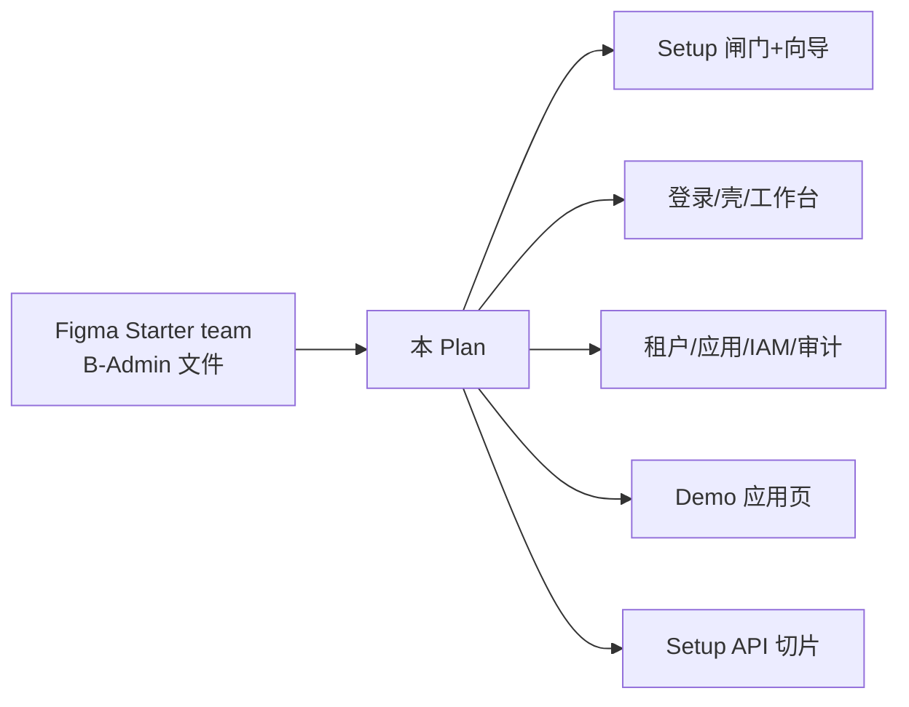

# Plan · B 端后台全量界面（Figma + antd/Pro 对齐 + 实施）

- Status: **Implemented · Figma Kit final 已重建**
- Date: 2026-11-02
- Figma team: **Allen's Starter team** (`team::1564839755933836437`)
- Figma **final（Kit）**: https://www.figma.com/design/aFM4yMG5k5LKybfVQlXUuR — Ant Design System v6 Community 实例
- Figma **wireframe / draft（旧）**: https://www.figma.com/design/GvtzsaCifrhr8k5sVaFN3t — 仅作 IA/路由对照，**不作视觉源**
- 前端栈：[ADR 0002](../../architecture/adr/0002-frontend-stack.md) · Ant Design 5 + ProComponents
- 设计规范：[../../design/figma-b-c-from-requirements.md](../../design/figma-b-c-from-requirements.md)
- Setup 方案：[../../architecture/setup-before-login.md](../../architecture/setup-before-login.md)
- 验收标准：结构与状态与 final Frame 一致（不以像素贴图为准；`web/` antd token 为视觉真相）

---

## 概览

在 Starter 团队下创建 Figma 设计文件，按 **antd / ProLayout / ProTable / ProForm / Steps / Result** 等组件心智绘制后台全量界面；设计节点与路由对齐后，按本 Plan 实施 `web/`（及 Setup 相关 `server/`）。



---

## 设计画板清单（B 端 · 1440 宽 · Shell 复用）

命名：`B/{module}/{page}/{state}`；组件对齐 antd。

| # | Frame 名 | antd / Pro 组件 | 路由 | 实施优先级 |
|---|----------|-----------------|------|------------|
| 0 | `B/setup/entry/default` | 登录壳 + CTA（未初始化闸门） | `/setup` 入口 | P0 |
| 1 | `B/setup/wizard/default` | Steps + Form + Card + Button | `/setup` | P0 |
| 2 | `B/setup/wizard/db-error` | Alert + Form | `/setup` | P0 |
| 3 | `B/setup/wizard/success` | Result | `/setup` → login | P0 |
| 4 | `B/auth/login/default` | LoginForm + 验证码 | `/login` | P0 |
| 4a | `B/auth/login/fail` | Alert + 表单 | `/login` | P0 |
| 4b | `B/auth/login/locked` | Alert + Result | `/login` | P0 |
| 5 | `B/shell/default` | ProLayout（图标侧栏+折叠+头像+通知+退出） | 壳 | P0 |
| 5a | `B/shell/collapsed` | 收起侧栏 64px | 壳 | P1 |
| 6 | `B/platform/dashboard/default` | Card + Statistic + Row/Col | `/platform/dashboard` | P1 |
| 7 | `B/platform/tenants/list` | ProTable + Tag + Button | `/platform/tenants` | P1 |
| 7a | `B/platform/tenants/detail` | Descriptions + Tabs + Tag | `/platform/tenants/:id` | P1 |
| 8 | `B/platform/tenants/form` | Modal/Drawer + ProForm | 租户新建/编辑 | P1 |
| 9 | `B/platform/apps/list` | ProTable + Tag | `/platform/apps` | P1 |
| 10 | `B/platform/apps/enable` | Modal + Switch/Select | 开通/停用 | P2 |
| 11 | `B/platform/iam/users` | ProTable + Tabs | `/platform/iam` | P1 |
| 12 | `B/platform/iam/roles` | ProTable + Tree(权限) | IAM Tab | P2 |
| 13 | `B/platform/audit/list` | ProTable + DatePicker | `/platform/audit` | P1 |
| 14 | `B/apps/demo/list` | ProTable | `/apps/demo/list` | P1 |
| 15 | `B/shared/empty` | Empty | 通用 | P2 |
| 16 | `B/shared/403` | Result 403 | 无权限 | P2 |

Tokens：主色 `#1677ff`（antd primary）、中性灰阶、圆角 6px（与现 ConfigProvider 一致）。

---

## Figma 交付物

- [x] 文件创建于 **Allen's Starter team**（Kit final + wireframe draft 分文件）
- [x] Pages：`00 Cover` / `01 Foundations` / `02 Brand` / `03 Components` / `04 Patterns` / `05 Features` / `06 References` / `07 Archive`
- [x] 视觉以 **02 Brand（logo）+ 06 References（login/dashboard/list+detail）** 为样板，正式交付稿在 **05 Features**；原子控件对齐 Ant Design System v6 Community
- [x] 上表 Frame 齐备（含 login 三态、dashboard、tenants list/detail/form、平台列表、Empty/403）
- [x] 每页可复制深链（含 node-id）写入下文「节点索引」A 表
- [x] status: **final**（验收看结构+状态+样板一致性，非像素）

### 节点索引

#### A. Kit final（研发深链 · 唯一视觉源）

| Frame | node-id | 深链 |
|-------|---------|------|
| 文件根 | — | https://www.figma.com/design/aFM4yMG5k5LKybfVQlXUuR |
| `B/Shell/Default`（展开） | `21:120` | [打开](https://www.figma.com/design/aFM4yMG5k5LKybfVQlXUuR?node-id=21-120) |
| `B/Shell/Collapsed`（收起） | `21:176` | [打开](https://www.figma.com/design/aFM4yMG5k5LKybfVQlXUuR?node-id=21-176) |
| `B/Header/UserMenuOpen` | `21:177` | [打开](https://www.figma.com/design/aFM4yMG5k5LKybfVQlXUuR?node-id=21-177) |
| `B/Header/NotificationPanel` | `21:220` | [打开](https://www.figma.com/design/aFM4yMG5k5LKybfVQlXUuR?node-id=21-220) |
| `B/Icons/Common` | `21:326` | [打开](https://www.figma.com/design/aFM4yMG5k5LKybfVQlXUuR?node-id=21-326) |
| `B/setup/entry/default` | `187:467` | [打开](https://www.figma.com/design/aFM4yMG5k5LKybfVQlXUuR?node-id=187-467) |
| `B/setup/wizard/default` | `20:5778` | [打开](https://www.figma.com/design/aFM4yMG5k5LKybfVQlXUuR?node-id=20-5778) |
| `B/setup/wizard/admin` | `20:5889` | [打开](https://www.figma.com/design/aFM4yMG5k5LKybfVQlXUuR?node-id=20-5889) |
| `B/setup/wizard/db-error` | `20:5996` | [打开](https://www.figma.com/design/aFM4yMG5k5LKybfVQlXUuR?node-id=20-5996) |
| `B/setup/wizard/success` | `20:6025` | [打开](https://www.figma.com/design/aFM4yMG5k5LKybfVQlXUuR?node-id=20-6025) |
| `B/auth/login/default` | `107:5804` | [打开](https://www.figma.com/design/aFM4yMG5k5LKybfVQlXUuR?node-id=107-5804) |
| `B/auth/login/fail` | `107:5899` | [打开](https://www.figma.com/design/aFM4yMG5k5LKybfVQlXUuR?node-id=107-5899) |
| `B/auth/login/locked` | `107:5996` | [打开](https://www.figma.com/design/aFM4yMG5k5LKybfVQlXUuR?node-id=107-5996) |
| `B/platform/dashboard/default` | `107:6093` | [打开](https://www.figma.com/design/aFM4yMG5k5LKybfVQlXUuR?node-id=107-6093) |
| `B/platform/tenants/list` | `110:10508` | [打开](https://www.figma.com/design/aFM4yMG5k5LKybfVQlXUuR?node-id=110-10508) |
| `B/platform/tenants/detail` | `110:9727` | [打开](https://www.figma.com/design/aFM4yMG5k5LKybfVQlXUuR?node-id=110-9727) |
| `B/platform/tenants/form` | `110:10053` | [打开](https://www.figma.com/design/aFM4yMG5k5LKybfVQlXUuR?node-id=110-10053) |
| `B/platform/apps/list` | `110:8423` | [打开](https://www.figma.com/design/aFM4yMG5k5LKybfVQlXUuR?node-id=110-8423) |
| `B/platform/iam/users` | `110:8749` | [打开](https://www.figma.com/design/aFM4yMG5k5LKybfVQlXUuR?node-id=110-8749) |
| `B/platform/audit/list` | `110:9075` | [打开](https://www.figma.com/design/aFM4yMG5k5LKybfVQlXUuR?node-id=110-9075) |
| `B/apps/demo/list` | `110:9401` | [打开](https://www.figma.com/design/aFM4yMG5k5LKybfVQlXUuR?node-id=110-9401) |
| `B/shared/empty` | `5:5160` | [打开](https://www.figma.com/design/aFM4yMG5k5LKybfVQlXUuR?node-id=5-5160) |
| `B/shared/403` | `5:5262` | [打开](https://www.figma.com/design/aFM4yMG5k5LKybfVQlXUuR?node-id=5-5262) |

#### B. Wireframe draft（旧 · 仅 IA）

| Frame | node-id | 深链 | status |
|-------|---------|------|--------|
| 文件根 | — | https://www.figma.com/design/GvtzsaCifrhr8k5sVaFN3t | draft |
| `B/setup/wizard/default` | `1:2` | [打开](https://www.figma.com/design/GvtzsaCifrhr8k5sVaFN3t?node-id=1-2) | draft |
| `B/setup/wizard/admin` | `1:42` | [打开](https://www.figma.com/design/GvtzsaCifrhr8k5sVaFN3t?node-id=1-42) | draft |
| `B/auth/login/default` | `1:72` | [打开](https://www.figma.com/design/GvtzsaCifrhr8k5sVaFN3t?node-id=1-72) | draft |
| `B/platform/dashboard/default` | `1:87` | [打开](https://www.figma.com/design/GvtzsaCifrhr8k5sVaFN3t?node-id=1-87) | draft |
| `B/platform/tenants/list` | `1:120` | [打开](https://www.figma.com/design/GvtzsaCifrhr8k5sVaFN3t?node-id=1-120) | draft |
| `B/platform/apps/list` | `1:167` | [打开](https://www.figma.com/design/GvtzsaCifrhr8k5sVaFN3t?node-id=1-167) | draft |
| `B/platform/iam/users` | `1:209` | [打开](https://www.figma.com/design/GvtzsaCifrhr8k5sVaFN3t?node-id=1-209) | draft |
| `B/platform/audit/list` | `1:254` | [打开](https://www.figma.com/design/GvtzsaCifrhr8k5sVaFN3t?node-id=1-254) | draft |
| `B/apps/demo/list` | `1:307` | [打开](https://www.figma.com/design/GvtzsaCifrhr8k5sVaFN3t?node-id=1-307) | draft |

设计对齐组件：Steps / Form / LoginForm / ProLayout / ProTable / Card / Statistic / Tabs / Tag / Button / Alert / Result。

---

## 实施任务（垂直切片）

### 切片 F — Figma（本阶段先完成）

1. [x] 在 Starter team 建文件 `go-react-admin B-Admin (antd)`
2. [x] Features 主路径 Frame（Setup×2 / Login / Dashboard / Tenants / Apps / IAM / Audit / Demo）
3. [x] 回填节点索引与深链
4. [x] Kit 重建：Foundations Variables + Shell + Form/403/Empty；旧稿降级 draft

### 切片 S — Setup 全栈（对齐 setup-before-login）

6. [x] server：status / test-connection / initialize（DSN+超管前端提交）
7. [x] web：`/setup` 向导按 Figma Steps；启动闸门
8. [x] 登录对接超管；ready 后禁 Setup 写接口（重复 initialize → 409）

### 切片 U — 平台与应用页对齐设计

9. [x] 按 Figma 升级 Login / Dashboard / TenantList(+Form) / AppList
10. [x] IAM 页改为 Tabs（用户/角色）结构；Audit 列表补筛选区
11. [x] Demo 列表与空态/403 共用组件
12. [x] module-map 回写；`pnpm build` + `go build` 验证（Postgres 端到端 initialize 待本机联调）

---

## 验收

- [x] Figma 文件在 Starter team 可打开，P0+P1 Frame 齐全（**Kit final**；旧稿已降级 draft）
- [x] Setup：未初始化 → 向导（DSN+超管）→ 登录（API+闸门已落地；完整 DB 初始化需本机 Postgres）
- [x] 租户/应用/IAM/审计/Demo 页面结构与稿一致（antd 组件可辨）
- [x] `pnpm build` + `go build` 通过

## 团队分工（Starter 流水线）

| 角色 | 职责 |
|------|------|
| Lead | 编排、回填节点、合入 |
| Designer | Figma 出图（antd 对齐） |
| Planner | 本 Plan 细化与风险 |
| Executor(s) | web/server 按切片实施 |
| Verifier | 对照 Figma + Setup 矩阵 |

实现话术：

```text
按 docs/ai-workflow/plans/admin-ui-figma-antd.md 执行
Figma: <文件深链>
范围: web + server(setup)
```
