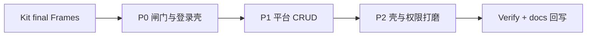

# Plan · Figma 终稿 → 前后端功能实现

- Status: **Active**
- Date: 2026-11-02
- 设计源（唯一视觉）：[Kit final](https://www.figma.com/design/aFM4yMG5k5LKybfVQlXUuR) · 节点索引见 [admin-ui-figma-antd.md](./admin-ui-figma-antd.md)
- 设计规范：[../../design/figma-b-c-from-requirements.md](../../design/figma-b-c-from-requirements.md)
- Setup 契约：[../../architecture/setup-before-login.md](../../architecture/setup-before-login.md)
- 研发对接：[../feature-dev-with-figma.md](../feature-dev-with-figma.md)
- 前端栈：Ant Design 5 + ProComponents（ADR 0002）

---

## 1. 目标

Figma B 端稿已初步完成并可直接使用。本 Plan 把 **画板 → 可运行全栈能力** 拆成可验收切片：

1. **UI 对齐终稿**：结构 / 主文案 / 主状态与 Frame 一致（不以像素贴图为准）
2. **API 贯通**：去掉占位数据，接 `server/` 真实接口；租户隔离与鉴权不破
3. **首装闭环**：未初始化 → 入口 → 向导 → 登录 → 壳内平台页



---

## 2. 现状差距（相对终稿）

| 区域 | 现状 | 差距 |
|------|------|------|
| Setup 入口 | 无独立页，直接进向导 | 缺 `B/setup/entry/default`（登录壳 + 三步摘要 + CTA） |
| Setup 向导 | 有 Steps/表单/API | 步骤文案未统一为「1 DSN / 2 超管 / 3 完成」；缺与终稿一致的品牌顶栏 |
| Login | 居中灰底 LoginForm | 缺左右分栏、品牌区、验证码区、失败/锁定态 |
| Shell | ProLayout mix + 深色 | 需对照 `01_Sidebar` / Topbar 信息架构（菜单文案已接近） |
| 租户/应用/IAM/审计/Demo | 多为本地占位 | server 已有 List 骨架；缺 Create/Update、详情路由、真联调 |
| Auth | Login API 已有 | 前端仍有 404/不可达时的本地占位登录，生产路径需收敛 |

**约定**：实现时 Web 编码前对关键 Frame 拉 `get_design_context` + `get_screenshot`；落地 antd，禁止照搬 MCP Tailwind。

---

## 3. 路由与 Frame 映射

| 路由 / 状态 | Frame | 优先级 |
|-------------|-------|--------|
| `/setup` 且未开始向导 | `B/setup/entry/default` | P0 |
| `/setup` step1 / 测连失败 | `wizard/default` · `wizard/db-error` | P0 |
| `/setup` step2 | `wizard/admin` | P0 |
| `/setup` 完成 | `wizard/success` | P0 |
| `/login` · fail · locked | `B/auth/login/*` | P0 |
| 壳 | `B/Shell/*` + Dashboard Top/Sidebar | P0/P1 |
| `/platform/dashboard` | `dashboard/default` | P1 |
| `/platform/tenants` · `:id` · form | `tenants/list|detail|form` | P1 |
| `/platform/apps` | `apps/list`（enable 模态） | P1 |
| `/platform/iam` | `iam/users`（roles Tab） | P1 |
| `/platform/audit` | `audit/list` | P1 |
| `/apps/demo/list` | `apps/demo/list` | P1 |
| 空态 / 403 | `shared/empty` · `shared/403` | P2 |

---

## 4. 垂直切片与任务

### 切片 P0-A — Setup 入口 + 向导对齐

- [x] `SetupEntry`：复用登录左栏品牌文案；右栏三步摘要 +「开始初始化」
- [x] 闸门：`need_setup` → 默认可先看入口，再进向导（本地 UI `phase`）
- [x] 向导步骤文案统一：`配置数据库连接（DSN）` / `设置平台超管账号` / `完成`
- [x] `db_unreachable` / 测连失败：Alert + DSN 重试（对照 db-error）
- [x] 成功态：Result「初始化完成」+「去登录」（可预填 username）
- [x] 顶栏品牌 Lockup（logo + `go-react-admin`）

### 切片 P0-B — 登录页对齐终稿

- [x] 左右分栏布局（品牌左 + 卡片右），对齐 `B/auth/login/default`
- [x] 失败态文案；连续失败/锁定提示（前端策略，≥5 次）
- [x] 验证码：UI 占位；仅非空校验，不阻断主路径
- [x] 去掉默认假登录（仅 `DEV && VITE_ALLOW_DEV_LOGIN=true`）

### 切片 P0-C — 壳与工作台基线

- [ ] BasicLayout：侧栏菜单顺序/文案对齐稿（工作台、租户、应用、用户角色、审计、Demo）
- [ ] Topbar：面包屑 + 用户区（管理员）结构对齐
- [ ] Dashboard：Statistic / Card 结构接真实或聚合 API（无则注明 mock 边界）

### 切片 P1-A — 租户全栈

- [x] server：`GET/POST /platform/tenants`，`GET/PATCH /platform/tenants/:id`
- [x] web：ProTable 接 API；Form Modal 创建/编辑
- [ ] 详情页路由对照 detail Frame
- [ ] 校验：跨租户不可见；无权限 → 403 组件

### 切片 P1-B — 应用开通 / IAM / 审计 / Demo

- [ ] Apps：列表 + 开通/停用（对接 `platform/app`）
- [ ] IAM：用户/角色 Tabs；最小 CRUD 或只读列表 + 权限树占位升级
- [ ] Audit：筛选区 + 列表接 API
- [ ] Demo：租户域列表接 `apps/demo`

### 切片 P1-C — 鉴权与权限打磨

- [ ] JWT 全链路；401 清会话回登录
- [ ] 权限码与菜单过滤（`usePermission` 去占位）
- [ ] Setup 完成后写接口 409 回归

### 切片 P2 — 体验与文档

- [ ] Empty / 403 全局复用
- [ ] 回写 `docs/web/module-map.md`、`docs/server/module-map.md`
- [ ] 首装 README / 环境说明；本 Plan Status → Implemented
- [ ] Verify：`pnpm build` + `go test`/`go build` + Setup 矩阵抽测

---

## 5. 验收标准

| 项 | 标准 |
|----|------|
| 设计对照 | P0/P1 主 Frame 结构与文案可辨识对齐；截图抽测通过 |
| Setup | 无 DSN → 入口 → 向导 → ready → 登录；坏 DSN 不落库；重复 initialize → 409 |
| 登录 | 超管可进壳；假登录默认关闭 |
| 租户 | 列表/创建/编辑走 API；租户头 `X-Tenant-Id` 业务接口生效 |
| 构建 | `pnpm build`、`go build ./...` 通过 |

---

## 6. 风险与默认决策

| 风险 | 默认 |
|------|------|
| 验证码无后端 | UI 展示，提交暂不校验；后面单开切片 |
| goose 未全量 | 继续 AutoMigrate / 现有 setup 路径，文档标明 |
| Figma 与 antd 密度差 | 以 antd 组件为准，保留信息架构 |
| 详情页工作量大 | 租户详情可先 Descriptions 一页，Tabs 后补 |

---

## 7. 执行顺序（本轮）

```text
P0-A → P0-B → P0-C → P1-A → P1-B → P1-C → P2
```

启动话术：

```text
按 docs/ai-workflow/plans/figma-to-fullstack-impl.md 执行
Figma: https://www.figma.com/design/aFM4yMG5k5LKybfVQlXUuR
范围: server + web
当前切片: P0-A
```
