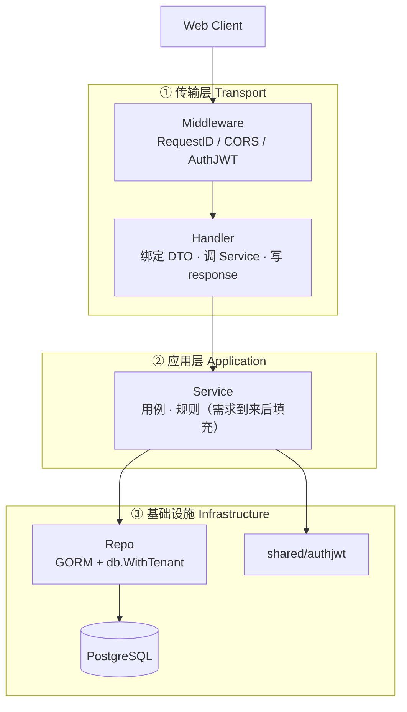
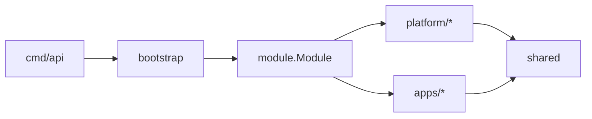

# 后端分层结构

- Status: Accepted（与脚手架同步）
- Date: 2026-11-01
- Relates: [ADR 0003](./adr/0003-backend-stack.md) · [server/conventions.md](../server/conventions.md)

## 请求路径



## 依赖规则

1. Handler → Service → Repo（只允许向下）
2. Service / Repo **不得**依赖 Gin；租户/用户从 `context.Context`（`shared/ctx`）或显式参数获取
3. `apps/<code>` 之间禁止互相 import；共享能力进 `shared` 或调用 `platform` 的 service 接口（按需）
4. `bootstrap` 只做装配：构造 Deps、挂载 `module.Module`

## 包结构



```text
internal/
├── bootstrap/           # NewRouter + 注册 Modules
├── module/              # Module 接口
├── config/
├── shared/
│   ├── middleware/
│   ├── authjwt/         # 签发/解析
│   ├── ctx/             # TenantID / UserID
│   ├── db/
│   ├── response|errors|pagination/
├── platform/<name>/
│   ├── module.go        # 实现 module.Module
│   ├── handler/
│   ├── service/
│   ├── repo/
│   ├── model/           # 可选占位
│   └── dto/             # 可选
└── apps/<code>/         # 同上
```

## 演进说明

当前各 service/repo 返回**示例数据**，不写真实业务。新需求按模块填充 service/repo，并补迁移与测试；不改变分层边界。
