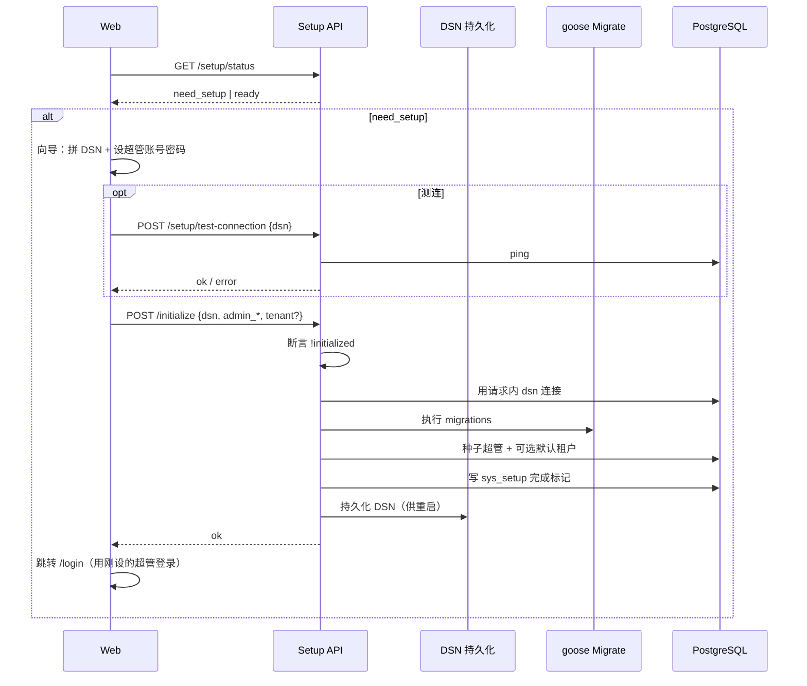

# 登录前系统初始化（Setup）

- Status: **Implemented**（DSN 与超管均由前端提交；迁移暂用 GORM AutoMigrate）
- Date: 2026-11-02
- Relates: [tenancy-multi-app.md](./tenancy-multi-app.md) · [layering.md](./layering.md) · ADR 待补 `0004`
- UI 实现要点（入口壳 / rem / SVG）：[../web/setup-entry-ui-notes.md](../web/setup-entry-ui-notes.md)

---

## 概览

在进入**登录及相关鉴权控制**之前，系统先判断是否已完成**数据库/平台初始化**。若未完成，强制进入**初始化向导界面**（不可登录）；完成后才开放 `/login`。

| 项 | 约定 |
|----|------|
| 触发时机 | 前端冷启动、访问登录页之前 |
| 判定 | 服务端 `GET /api/v1/setup/status` |
| 初始化 | 界面填写并提交 **DSN + 默认超管账号** → `POST /api/v1/setup/initialize` |
| DSN | **由前端在 Setup 向导中组装/填写**；成功后由服务端持久化，供进程重启后使用 |
| 超管 | **由前端在初始化时设置**（用户名、密码等），写入 `platform_users` |
| 完成后 | 写入初始化标记；Setup 写接口拒绝再次执行；前端不再展示可提交的 Setup 表单 |

```mermaid
flowchart TB
  Start[打开控制台] --> Status[GET /setup/status]
  Status -->|initialized=true| Login[/login 登录]
  Status -->|initialized=false| Setup[/setup 初始化向导]
  Setup --> Form[填写 DSN 表单 + 超管账号]
  Form --> Test[可选 POST /setup/test-connection]
  Test --> Run[确认初始化]
  Run --> Init[POST /setup/initialize<br/>dsn + admin + tenant?]
  Init -->|ok 持久化 DSN| Login
  Init -->|fail| Setup
  Login --> Auth[既有登录与鉴权]
```



---

## Intake

### Problem

首装或空库时，用户若直接走登录，会出现「连不上库 / 无表 / 无账号」等混乱状态。需要在登录控制之前明确：**是否需要初始化**，并通过界面一次性完成 **数据库连接（DSN）配置** 与 **默认超管账号** 设定。

### Actors

| 角色 | 说明 |
|------|------|
| 首次部署运维 / 安装人 | 在 Setup 页填写 DSN、设定超管；无登录态 |
| 平台超管 | Setup 时由前端设定的账号；完成后用于登录 |
| 普通租户用户 | 不参与 Setup |

租户范围：Setup 属**平台级**；可顺带创建默认租户，Setup 本身不按业务 `tenant_id` 隔离。

### In scope

- [x] 公开 Status API（无需登录）
- [x] 未初始化时前端拦截并进入 Setup UI
- [x] **前端组装/填写 DSN**（主机、端口、库名、用户、密码、SSL 等 → 生成连接串）
- [x] **前端设置默认超管**（用户名、密码、显示名）
- [x] 可选：测连接口
- [x] 服务端执行迁移、种子、标记完成，并**持久化 DSN**
- [x] 初始化完成后锁定 Setup，进入正常登录流
- [x] 文档与 Plan

### Out of scope（本阶段不做）

- 初始化完成后在 UI 中随意修改生产 DSN（属运维配置变更，另开需求）
- 重复初始化 / 一键清库
- 与外部 IdP/SSO 的首装绑定
- Figma 精修（antd Steps/Form，`n/a`）

### Success criteria

- [ ] 未初始化时进入 `/setup`，不能靠登录进业务
- [ ] Setup 页可配置 DSN（表单生成）并设置超管账号密码
- [ ] 测连（若实现）能反馈可达/失败原因摘要
- [ ] initialize 成功后：迁移完成、超管可登录、进程重启后仍用持久化 DSN
- [ ] 再次 initialize 被拒绝
- [ ] 已初始化环境登录流回归正常

### UI / Design

- Figma: 无  
- 状态: n/a  
- 向导建议步骤：① 数据库连接 ② 超管账号 ③ 确认执行 ④ 结果跳转登录  

### Constraints

- DSN、超管密码仅在 **未初始化** 时经由 HTTPS/本地受信通道提交；**前端不长期持久化密码与 DSN**（不要写入 localStorage）
- 服务端必须在 `initialized=true` 后关闭 initialize / test-connection（或 test 仅内网运维另议）
- 超管密码哈希存储（bcrypt）；DSN 持久化避免明文进仓库（写本地 `config.yaml` / 环境侧文件，且 gitignore）
- Setup 写接口限流，防未初始化窗口期被扫

### 触及端

- `server/`：setup、migrate、DSN 持久化、种子用户  
- `web/`：Setup 向导（DSN 表单 + 超管表单）、闸门  
- `docs/` / `deploy/`：首装说明  

---

## 方案（Approach）

### 选定方案：前端提交 DSN + 超管；服务端迁移、种子并持久化 DSN

**为什么**

1. 满足「界面完成首装」：无库时不必先改服务器 env 再打开 UI  
2. 超管账号由安装人当场设定，避免写死 `admin/admin`  
3. 成功后服务端保存 DSN，保证 API 进程重启可连库  

**相对旧方案的变更**

| 旧约定 | 新约定 |
|--------|--------|
| DSN 仅服务端 env | **前端生成/填写 DSN 并在 initialize 提交** |
| 超管可后端默认种子 | **超管用户名密码一律前端设置** |
| 无 DSN 则卡在「先配服务器」 | 无持久化 DSN 即 `need_setup`，向导内配置 |

**仍不选**

| 备选 | 原因 |
|------|------|
| 纯命令行 goose | 不满足界面控制 |
| DSN 只存在浏览器 | 重启 API 无法连库 |
| 每次启动自动 migrate | 与显式确认冲突；默认关 |

### 前端如何「生成」DSN

向导「数据库」步骤用表单字段拼 PostgreSQL URL/DSN，例如：

| 字段 | 示例 |
|------|------|
| host | 127.0.0.1 |
| port | 5432 |
| database | gra_admin |
| user | gra |
| password | **** |
| sslmode | disable / require |
| timezone | Asia/Shanghai |

生成示例：

```text
host=127.0.0.1 user=gra password=*** dbname=gra_admin port=5432 sslmode=disable TimeZone=Asia/Shanghai
```

（实现时可同时支持「高级：粘贴完整 DSN」切换。）

### 超管字段（前端必填）

| 字段 | 规则 |
|------|------|
| admin_username | 必填，唯一 |
| admin_password | 必填，最小长度等基础强度 |
| admin_password_confirm | 前端校验一致 |
| admin_display_name | 可选 |
| bootstrap_tenant_name | 可选，默认「默认租户」 |

### 初始化判定

`initialized=true` 当且仅当：

1. 服务端已有**可用持久化 DSN** 且能连通  
2. 基线迁移已应用  
3. `sys_setup` 已完成 **且** 存在平台超管用户  

未持久化 DSN 或标记未完成 → `need_setup`（向导可填连接与超管）。

### DSN 持久化（服务端）

成功 initialize 后写入（择一，实现时定，推荐 1）：

1. **本地文件** `configs/config.local.yaml`（或 `.data/dsn`）— 已在 `.gitignore`  
2. 或更新进程内配置并依赖外部挂载的 secret 文件  

**禁止**把含密码的 DSN 提交进 git。  
Status 对前端**不回传**完整 DSN/密码；最多 `db_host_masked` 类展示。

### Status 契约（草稿）

`GET /api/v1/setup/status`

```json
{
  "code": 0,
  "data": {
    "state": "need_setup | ready | db_unreachable",
    "initialized": false,
    "dsn_persisted": false,
    "db_reachable": false,
    "migrations_pending": true,
    "has_admin": false,
    "message": "optional hint"
  }
}
```

说明：`db_unreachable` 表示**已持久化 DSN 但当前 ping 失败**（库挂了）；与「尚未 Setup」区分。尚未 Setup 用 `need_setup`。

### Test connection 契约（推荐做）

`POST /api/v1/setup/test-connection`（仅 `!initialized`）

```json
{ "dsn": "host=... user=... password=... dbname=... port=5432 sslmode=disable" }
```

或结构化字段由服务端拼接。返回可达 / 错误摘要（勿回显密码）。

### Initialize 契约（草稿）

`POST /api/v1/setup/initialize`（仅 `!initialized`）

```json
{
  "dsn": "host=127.0.0.1 user=gra password=*** dbname=gra_admin port=5432 sslmode=disable TimeZone=Asia/Shanghai",
  "admin_username": "admin",
  "admin_password": "...",
  "admin_display_name": "管理员",
  "bootstrap_tenant_name": "默认租户"
}
```

服务端步骤：

1. 校验 `!initialized`、密码强度、DSN 非空  
2. **Ensure DB**：解析 DSN 中的 `dbname`；若不存在则先连维护库（`postgres`，失败再试 `template1`）执行 `CREATE DATABASE`，再连目标库并 ping（测连 `test-connection` 同逻辑）  
3. AutoMigrate（当前实现；原计划 goose up）  
4. 事务内：创建超管（hash 密码）、可选默认租户、写 `sys_setup`  
5. 持久化 DSN  
6. 热切换进程内 `*gorm.DB`（或提示重启——**优先热切换**，避免用户再起一次进程）

说明：

- 建库需要连接账号具备 `CREATEDB`（或超级用户）权限；系统库名（`postgres` / `template0` / `template1`）不会尝试创建。  
- 进程启动时的 `db.Open` **不会**自动建库；仅 Setup 测连 / 初始化走 `OpenEnsuring`。  
- 测连成功且新建了库时，返回文案可含 `database created`。

失败：返回明确错误；尽量不写 `sys_setup`；DSN 未成功前不持久化。

### 前端闸门与向导

```text
启动 → status
  need_setup     → /setup（Steps：DSN → 超管 → 执行）
  db_unreachable → /setup 只读提示检查数据库（已初始化场景）
  ready          → /login
```

- 未 `ready` 禁止进入业务壳与有效登录成功进首页  
- Setup 成功后清表单内存态，跳转登录并可用**刚设置的超管**登录  

### 安全要点

- initialize / test-connection：**无 JWT**，窗口期仅 `!initialized`  
- 完成后必须 409/403  
- IP 限流 + slog  
- 响应与日志脱敏（密码、DSN 密码段）  
- 生产建议 TLS，避免安装窗口期被旁路窃听  

### 模块落点

| 位置 | 职责 |
|------|------|
| `platform/setup` | status / test-connection / initialize |
| `shared/db` + migrate | 连接、goose、初始化后 ReplaceDB |
| DSN store | 读写本地安全配置 |
| `web/.../setup` | DSN 生成表单 + 超管表单 + 闸门 |

---

## Plan（具体任务）

### Impact

- platform: `setup` + 最小 `platform_users`；auth 在 ready 后校验超管  
- migrations: `sys_setup` + `platform_users`（+ 可选 tenants 种子）  
- web: Setup 向导（DSN + 超管）  
- docs / ADR-0004  

### 数据流

```text
Setup UI 生成 dsn + admin
  → test-connection? 
  → initialize(dsn, admin)
  → migrate + seed + persist dsn + mark ready
Login(admin) → JWT → 业务
```

### Tasks

**切片 A — 状态与存储骨架（server）**

1. [ ] 迁移：`sys_setup`、`platform_users`  
2. [ ] DSN 持久化读写（gitignore 路径）+ 启动时若已持久化则 `db.Open`  
3. [ ] goose 封装（up / 版本查询）  
4. [ ] `GET /setup/status`；Module 挂 Public  

**切片 B — 测连与初始化（server）**

5. [ ] `POST /setup/test-connection`（仅未初始化）  
6. [ ] `POST /setup/initialize`：收 **dsn + admin_*** → 迁移 → 种子超管/租户 → 标记 → 持久化 DSN → 热更新 DB  
7. [ ] 完成后拒绝写接口；限流；日志脱敏  
8. [ ] 测试：未初始化成功路径 / 坏 DSN / 重复初始化 / 重启后 ready  

**切片 C — 前端向导（web）**

9. [ ] 启动闸门：need_setup → `/setup`  
10. [ ] Step1：DSN 表单（字段拼接 + 可选高级粘贴）+ 测连按钮  
11. [ ] Step2：超管用户名/密码/确认（必填）+ 可选租户名  
12. [ ] Step3：提交 initialize → 成功跳转登录（可预填用户名、不预填密码）  
13. [ ] `db_unreachable` 只读提示  

**切片 D — 登录衔接与文档**

14. [ ] 登录对接真实超管校验（ready 环境）  
15. [ ] module-map、README 首装、本文 Status→Implemented；补 ADR-0004  
16. [ ] Verify 全矩阵  

### 验证矩阵

| 用例 | 期望 |
|------|------|
| 全新安装无持久化 DSN | need_setup，向导可填 DSN+超管 |
| 错误 DSN 测连/初始化 | 失败提示，不标记完成、不持久化 |
| 正确 DSN + 超管初始化 | ready，超管可登录 |
| 初始化后重复 initialize | 拒绝 |
| 重启 API | 读持久化 DSN，status.ready |
| 前端刷新 | 不残留 DSN/密码在 localStorage |
| 跨租户 | 业务表仍 WithTenant |

### Open questions（默认）

| 问题 | 默认 |
|------|------|
| DSN 持久化介质 | `configs/config.local.yaml` 或 `.data/setup.json`（gitignore） |
| 初始化成功是否强制重启 | 优先热切换 DB；失败再提示重启 |
| 超管是否绑租户 | platform 级；可选默认租户 |
| 密码算法 | bcrypt |

### 出口条件（Plan）

- [x] 任务可验证；契约含 **前端 DSN + 前端超管**  
- [ ] 确认后按 A→D Implement  

---

## 文档索引

- 多租户总览：[tenancy-multi-app.md](./tenancy-multi-app.md)  
- Plan 索引：[../ai-workflow/plans/setup-before-login.md](../ai-workflow/plans/setup-before-login.md)  
