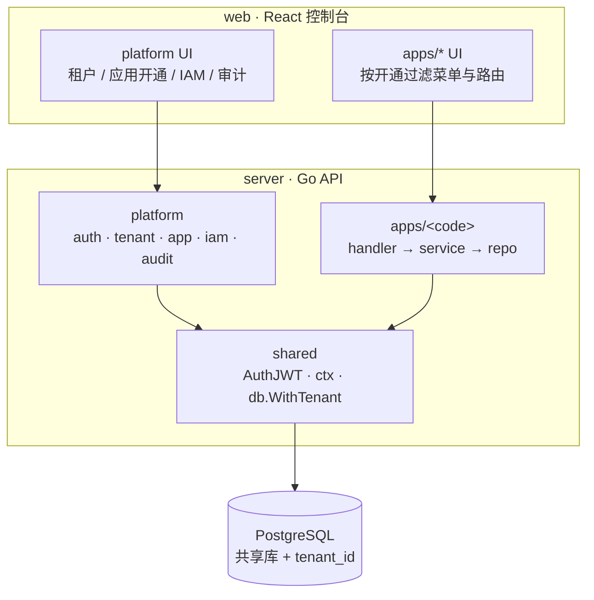
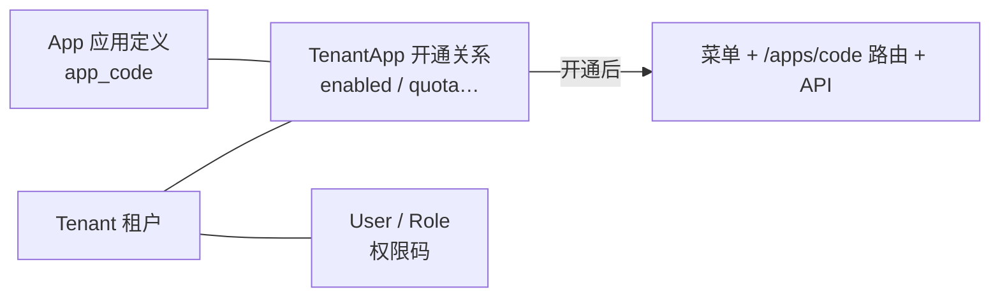
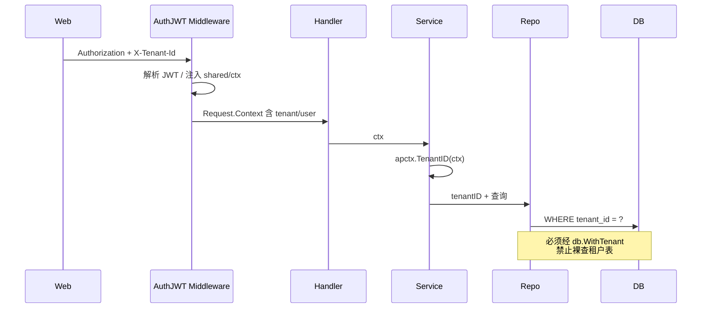
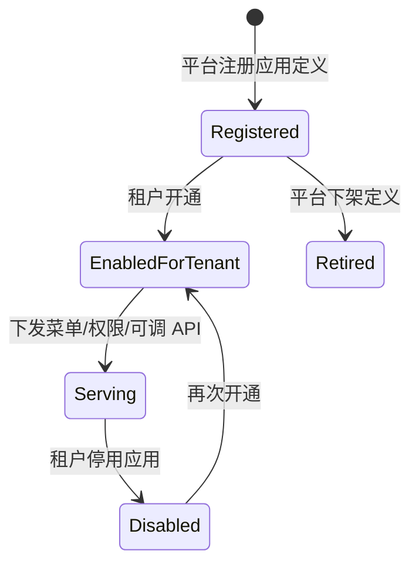
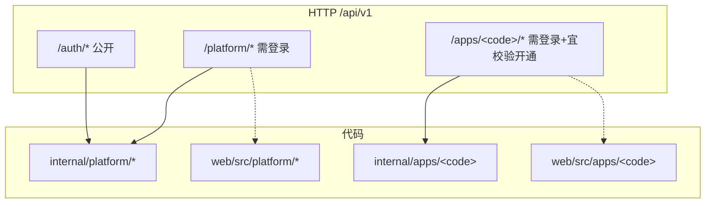

# 多租户 × 多应用：管理与实现总览

- Status: Intake 梳理（设计约定 + 当前脚手架现状）
- Date: 2026-11-02
- 相关：[tenancy.md](./tenancy.md) · [multi-app.md](./multi-app.md) · [ADR 0001](./adr/0001-shared-db-tenant-id.md) · [layering.md](./layering.md)

---

## 概览

Go-React-Admin 是一套**平台壳 + 可挂载业务应用**的管理后台：

| 维度 | 一句话 |
|------|--------|
| 多租户 | 共享库 + 行级 `tenant_id`；请求上下文注入租户；业务读写强制 scope |
| 多应用 | 平台注册应用定义；租户开通后才可见菜单/API；代码按 `apps/<app_code>` 隔离 |
| 谁管什么 | **Platform** 管租户/应用/IAM/审计；**Apps** 只管领域功能，不自建登录与租户解析 |
| 现状 | 骨架与示例 API/页面已通；持久化开通、动态菜单、真实 RBAC **待需求迭代** |

**管理（产品能力）** 与 **实现（代码落点）** 对照见下文；先看总图。

---

## 总体关系（Mermaid）

### 1. 逻辑全景



### 2. 租户 × 应用绑定



### 3. 请求期租户注入与数据隔离



### 4. 应用生命周期（管理视角）



### 5. 代码与路由映射



---

## Intake 陈述

### Problem

需要一份统一说明：多租户与多应用在本系统中**如何管理、如何实现、现状与缺口**，作为后续功能开发的 Intake/设计入口。

### Actors

| 角色 | 能力边界 |
|------|----------|
| 平台超管 | 租户 CRUD、应用定义、跨租户审计；不直接写业务单据 |
| 租户管理员 | 为本租户开通/停用应用、管本租户用户角色（目标能力） |
| 租户成员 | 仅使用已开通应用内功能；数据不出本租户 |
| 业务应用开发 | 只在 `apps/<code>`（及对应 web）交付领域功能 |

### In scope（本文）

- 概念模型、隔离规则、管理职责、代码/路由落点
- 当前脚手架已实现 vs 待建能力清单
- 与前后端 module-map / 分层文档的索引

### Out of scope（本文）

- 真实业务字段与页面交互细节
- 计费、配额算法、独立库/Schema 隔离（若未来需要另开 ADR）
- 微前端拆包

### Success criteria（本文完成标准）

- [x] 顶部有概览 + 总体 Mermaid
- [x] 管理职责与实现映射可对照
- [x] 现状/缺口明确，可供后续需求挂接

---

## 管理模型（产品 / 运营视角）

### 平台管理什么

| 能力 | 说明 | 目标归属 |
|------|------|----------|
| 租户管理 | 创建/停用/基本信息 | `platform/tenant` + 控制台「租户管理」 |
| 应用目录 | 注册 `app_code`、显示名、是否可开通 | `platform/app` 定义侧 |
| 应用开通 | 租户 ↔ 应用绑定、启停 | `platform/app` 开通侧 |
| 身份权限 | 用户、角色、权限码、菜单 | `platform/iam` + `auth` |
| 审计 | 开通、登录、跨租户等高危操作 | `platform/audit` |

### 租户侧看到什么

1. 登录后进入**当前租户**上下文（可切换时仅限授权角色）。
2. 菜单 = 平台公共菜单 + **已开通**应用的菜单。
3. 调用 `/apps/<code>/*` 时：未开通应 403（目标行为；现状为示例未强校验）。

### 权限码约定

| 前缀 | 示例 | 用途 |
|------|------|------|
| `platform:` | `platform:tenant:read` | 平台能力 |
| `<app_code>:` | `demo:item:read` | 某业务应用 |

未开通应用：即使角色上有该前缀权限，也不应下发菜单；API 层仍建议校验开通状态（纵深防御）。

---

## 实现模型（工程视角）

### 隔离策略（已定）

见 [ADR 0001](./adr/0001-shared-db-tenant-id.md)：

- 共享 PostgreSQL，租户业务表带 `tenant_id` + 索引
- Repo 经 `internal/shared/db.WithTenant`
- 上下文：`AuthJWT` → `shared/ctx`（`TenantID` / `UserID`）
- 请求头：`X-Tenant-Id`（与 JWT 内 tid 配合；目标：无切换权则忽略或拒绝伪造）

### 分层与模块

见 [layering.md](./layering.md)：

- 每个 platform 子域 / 每个 app：`module.go` + `handler` → `service` → `repo`
- `bootstrap` 注册 `module.Module`；apps 互不 import

### 前后端落点

| 概念 | Server | Web |
|------|--------|-----|
| 登录 / JWT | `platform/auth` | `platform/auth`、`shared/auth` |
| 租户 | `platform/tenant` | `platform/tenant`、`shared/tenant` |
| 应用开通 | `platform/app` | `platform/app` |
| IAM | `platform/iam` | `platform/iam`、`shared/access` |
| 业务应用 | `internal/apps/<code>` | `src/apps/<code>` |
| 租户 scope | `shared/db`、`shared/ctx` | 请求头 + store，禁止页面写死 |

### 目标数据实体（尚未全部建表）

```text
tenants                         # 已有示例迁移
apps                            # 应用定义（待建）
tenant_apps (tenant_id, app_code, status)   # 开通关系（待建）
users / roles / role_permissions / menus    # IAM（待建）
<app>_tables (…, tenant_id)     # 各应用业务表；demo_items 已有示例
```

### 当前脚手架现状（2026-11）

| 项 | 状态 |
|----|------|
| JWT 登录示例、dev-token | 有 |
| 中间件注入 tenant/user ctx | 有 |
| `WithTenant` 助手 | 有（示例 repo 尚未真查库） |
| 租户/应用/IAM/审计/demo 示例 API | 有（内存/占位数据） |
| 前端平台页 + demo 列表 + 静态菜单 | 有 |
| 应用定义表 + 开通表 + 开通校验中间件 | **无** |
| 后端下发动态菜单 | **无**（前端 `menu-config` 静态） |
| 真实 RBAC 持久化 | **无** |

---

## 示例闭环（demo）

打通认知用的最小路径（已实现为 example）：

```text
登录 → 带 tenant 调 GET /api/v1/apps/demo/items
     → Service 读 apctx.TenantID
     → 返回带 tenant 备注的占位列表
前端：/apps/demo/list
```

后续真实需求应补齐：**租户开通 demo → 菜单可见 → API 校验开通 → demo_items 落库 + WithTenant**。

新增应用流程提示词：[../ai-workflow/prompts/new-app.md](../ai-workflow/prompts/new-app.md)

---

## 缺口与后续需求挂接（非本 Intake 实现）

按优先级建议：

1. **登录前系统初始化（Setup）**：空库检测 + 界面触发迁移/种子超管 — 见 [setup-before-login.md](./setup-before-login.md)
2. **租户/应用持久化模型** + goose 迁移（`apps`、`tenant_apps`）
3. **开通校验**（中间件或 service）：未开通禁止 `/apps/<code>`
4. **动态菜单 API**：按租户开通 + 权限码过滤；前端去掉静态写死业务菜单
5. **IAM 持久化**与权限中间件（与 Setup 种子超管衔接）
6. **审计**写入开通/登录/跨租户操作
7. 切换租户的授权策略写死到 ADR/本文「请求解析」并加测

---

## 文档索引

| 文档 | 用途 |
|------|------|
| 本文 | 多租户×多应用总览（管理 + 实现 + 现状） |
| [tenancy.md](./tenancy.md) | 租户隔离细则速查 |
| [multi-app.md](./multi-app.md) | 应用约定与清单速查 |
| [../server/module-map.md](../server/module-map.md) | 后端模块状态 |
| [../web/module-map.md](../web/module-map.md) | 前端模块状态 |
| [../ai-workflow/feature-dev-with-figma.md](../ai-workflow/feature-dev-with-figma.md) | 功能开发流程 |
