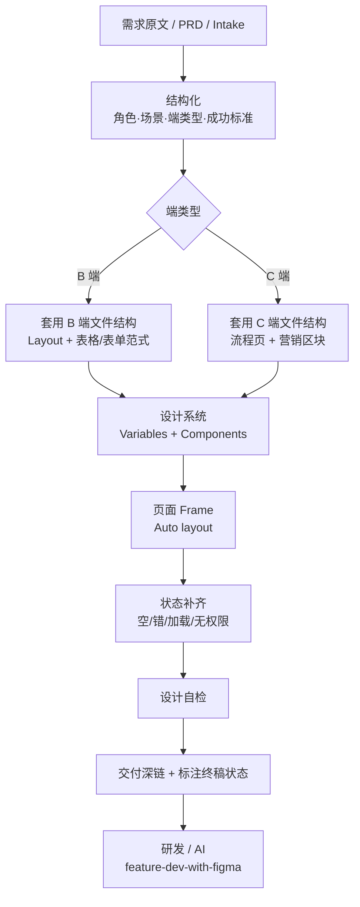
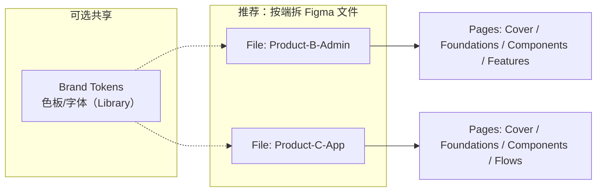

# 按需求在 Figma 独立绘制 B 端 / C 端设计图（最优方式）

- Status: Accepted（设计侧 SOP）
- Date: 2026-11-02
- 下游研发对接：[../ai-workflow/feature-dev-with-figma.md](../ai-workflow/feature-dev-with-figma.md)
- 本仓库 B 端实现栈：Ant Design / ProComponents（[ADR 0002](../architecture/adr/0002-frontend-stack.md)）

---

## 概览

**最优原则**：需求先结构化 → 选对「端类型」模板 → 用设计系统（变量+组件）拼页面 → 状态补齐 → 交付**带 node-id 的 Frame 深链**。  
不要从空白画板「临摹感觉」；B 端优先**信息架构与表格/表单密度**，C 端优先**转化路径与视觉层级**。

| | **B 端（后台 / 运营 / 多租户控制台）** | **C 端（用户前台 / 营销 / 消费端）** |
|--|----------------------------------------|--------------------------------------|
| 目标 | 效率、一致性、权限可见、可扫读 | 理解成本低、情绪与品牌、转化 |
| 密度 | 高（表、筛、批量、抽屉） | 中低（一屏一主题） |
| 组件策略 | 对齐 Ant Design / Pro 模式 | 品牌化组件；少用「后台表」心智 |
| 关键帧 | 1440 / 1280 桌面为主 | 375 + 1440（移动优先或双端） |
| 与本仓关系 | 直接驱动 `web/` 管理台 | 若另有 C 端应用再映射；勿与 B 端文件混用同一套页面库 |

---

## 总体流程（Mermaid）





---

## 1. 需求 → 可画输入（先于打开 Figma）

用一张「设计 Intake」卡住范围（可与研发 Intake 共用字段）：

```markdown
## Design Intake
- 端类型: B | C | 双端（拆成两份稿）
- 角色: …
- 主场景（用户一句话）: …
- 成功标准（可验收）: …
- 页面清单（信息架构）: 1. … 2. …
- 关键数据对象/字段: …
- 权限/租户差异是否影响 UI: 是/否（B 端必答）
- 参考竞品或旧版: …
- 终稿预期: final | draft（影响是否 1:1 还原）
```

**最优习惯**：先写**页面清单 + 每页目的**，再进 Figma；禁止边想边铺十个无标题 Frame。

---

## 2. Figma 文件与 Page 结构（最优默认）

### 2.1 文件拆分

| 策略 | 做法 | 原因 |
|------|------|------|
| **推荐** | B 端、C 端**分文件** | 组件库心智不同，避免后台表单污染 C 端 |
| 可共享 | 仅 Brand Tokens（色/字/圆角）发成 Library | 品牌一致，交互模式仍分开 |
| 避免 | 一个巨大文件里 B/C 页面混排、组件无前缀 | 检索与 MCP 取节点易错 |

### 2.2 单文件内 Page 顺序

```text
00 Cover          — 产品名、端类型、版本、联系人
01 Foundations    — Variables：Color / Type / Space / Radius
02 Brand          — Logo / lockup / app icon（品牌唯一源）
03 Components     — 原子与业务组件（B：Table/Filter/Form；对齐 antd Kit）
04 Patterns       — 布局范式（B：ProLayout 壳；Header 菜单/通知）
05 Features       — 按需求/Epic 分节的正式交付稿（研发深链只指向这里）
06 References     — 视觉样板（login / dashboard / list+detail），只读参考
07 Archive        — 废弃稿，勿给研发深链
```

### 2.3 命名规范（方便人与 AI）

```text
Frame:    [B|C]/{app_or_module}/{page}/{state}
示例:     B/platform/tenants/list
          B/apps/demo/items/list
          C/home/default
          C/checkout/error-payment

Component: B/Button/Primary  |  C/Button/Primary
Variant:   size=md, state=hover, tone=danger
```

交付研发时：复制 **Frame 的链接**（URL 含 `node-id=`），并在注释写 `status: final`。

---

## 3. B 端最优画法（对齐本仓后台）

### 3.1 先定壳，再填页

本仓控制台默认 **侧栏 + 顶栏 + 内容区**（ProLayout 心智）。在 `03 Patterns` 做好：

- `B/Shell/Default`：侧栏菜单、租户展示位、用户区、内容槽  
- 内容槽内只换「页内模块」，**不要每页重画整壳**（用 Component 实例）

### 3.2 页面类型优先级（按使用频率）

| 类型 | 画什么 | 对应实现倾向 |
|------|--------|--------------|
| 列表页 | 筛选区 + 表格 + 行操作 + 分页 | ProTable |
| 表单页 / 抽屉 | 分组字段、校验提示、主次按钮 | ProForm / Drawer |
| 详情页 | 描述列表 + 关联 Tab | Descriptions + Tabs |
| 仪表盘 | 少而准的指标卡（避免首屏堆无动作模块） | Card + Statistic |
| 权限空态 | 无权限、未开通应用 | Result / Alert |

### 3.3 B 端密度与栅格

- 桌面画板：**1440×900**（或 1280 内容宽）  
- 内容区常用 **24px** 外边距；表单标签右对齐或顶对齐二选一并写进 Foundations  
- 表格列：先满足「扫读主键 + 2～4 个决策字段」，次要进详情  
- **租户 / 应用**：顶栏或侧栏有租户标识；应用菜单按「已开通」示意（可用注解，不必做真交互）

### 3.4 必画状态（B 端 DoD）

每张主列表/表单至少附带变体或同页旁注：

- [ ] Loading / Skeleton  
- [ ] Empty  
- [ ] Error  
- [ ] No permission / App not enabled（多应用场景）  
- [ ] 成功反馈（Message / 结果页）

### 3.5 与 Ant Design 对齐的技巧

- Components 命名可贴近 antd 概念（Table、Form、Modal），**视觉 token** 用 Variables，避免魔法色  
- 不追求与 antd 官网皮肤 100% 一致，但**结构**（筛+表+操作列）保持可落地  
- 复杂动效、花哨插画：B 端默认降优先级  

#### 硬规则（B 端 `final` 交付）

1. **B 端 `final` 必须基于 Ant Design Figma Kit 实例**（当前可用：Ant Design System v6 Community）。原子控件（Button / Input / Table / Steps / Result / Alert / Tag / Empty / Tabs / Modal 等）禁止手绘矩形冒充。  
2. **手绘矩形 / AI 线框只能进 `draft` 或 `06 Archive`**，不得作为研发视觉源深链。  
3. Designer / AI 出图前先 `search_design_system` / 挂 Library；**禁止从空白 Frame「临摹 antd 感觉」**。  
4. 交付前自检：  
   - [ ] 同一 `B/Shell/Default` 范式（侧栏+顶栏+内容槽），禁止每页重画整壳  
   - [ ] Foundations Variables 无魔法色（主色对齐 `#1677ff`、圆角 6）  
   - [ ] 主列表/表单含 Empty / Error / 无权限（或 Loading）变体  
5. **验收标准**：结构与状态与 final Frame 一致；**不以像素贴图为准**。实现侧以 `web/` 真实 antd / Pro token 为视觉真相。  

Kit final 文件（本仓）：`go-react-admin B-Admin (antd Kit)` · wireframe draft：`go-react-admin B-Admin (antd)`。

---

## 4. C 端最优画法

### 4.1 先定用户旅程，再定页面

在 `05 Flows` 用简单节点：

```text
进入 → 理解价值 → 关键行动 → 完成 / 失败回退
```

每页 Frame 对应旅程一步；一页只强调**一个主 CTA**。

### 4.2 关键帧

| 端 | 画板 | 说明 |
|----|------|------|
| 移动优先产品 | 375 宽 | 先画 Mobile，再适配 Desktop |
| 桌面官网 / 控制台旁的门户 | 1440 | 可与 B 端同宽但**组件库分离** |

### 4.3 C 端区块范式

- Hero（品牌/价值一句话 + CTA）  
- 信任/证明（可选，勿堆数据墙）  
- 功能说明（少卡片、多叙事）  
- 转化区（注册/购买）  
- 页脚  

遵循「一屏少目标」：首屏通常只要品牌 + 一句价值 + 一组 CTA（与营销落地页原则一致）。

### 4.4 C 端必画状态

- [ ] 默认  
- [ ] 表单校验错误  
- [ ] 提交中 / 成功 / 失败  
- [ ] 登录态差异（若有）  
- [ ] 关键断点（若承诺响应式）

### 4.5 与 B 端隔离

- 不要复用 B 端 Table 密集组件到 C 端首页  
- 共享仅限 Tokens；按钮等组件用 `C/` 前缀另建  

---

## 5. 设计系统最小集（两端都要）

在 `01 Foundations` 用 **Figma Variables**（优先于散落色值）：

| 集合 | 最少包含 |
|------|----------|
| Color | 品牌主色、成功/警告/错误、背景层级、边框、文字主/次 |
| Type | 标题 / 正文 / 辅助（两端可不同 Scale） |
| Space | 4/8/12/16/24/32 |
| Radius | sm/md/lg |

Components 规则：

1. 全部 **Auto layout**  
2. 用 Variants 表达状态，勿复制 10 份散 Frame  
3. 图标统一一种来源（Stroke 一致）  
4. 发 Library 前删掉未命名 `Frame 123`  

---

## 6. 从需求到出图的「一日最优」节奏

适合独立设计师或 AI 辅助出第一版：

| 时段 | 动作 | 产出 |
|------|------|------|
| 0–20min | Design Intake + 页面清单 | 清单勾选 |
| 20–40min | 选文件 / 套 Patterns 壳 | 空壳页面树 |
| 40–90min | 主路径 1～3 个高保真 Frame | 可评审主路径 |
| 90–120min | 补空态/错误/无权限 | 状态齐 |
| 收尾 | 命名、终稿标记、复制深链 | 可交给研发 |

**草稿策略**：`draft` 只保证信息架构与主按钮；视觉精修标 `final` 后再要求 1:1 还原。

---

## 7. 交付给研发 / AI 的标准包

每个需求交付最少包含：

1. **Frame 深链**（含 `node-id`），不要只给文件首页  
2. 设计状态：`final` / `draft` / `reference-only`  
3. 页面清单与角色  
4. （可选）Flows 截图或说明  
5. 标注「对齐 antd」或「允许视觉偏差」的冲突处理偏好  

研发侧执行：[feature-dev-with-figma.md](../ai-workflow/feature-dev-with-figma.md)  
提示词：[../ai-workflow/prompts/feature-figma.md](../ai-workflow/prompts/feature-figma.md)

---

## 8. 自检清单

### 通用

- [ ] 端类型正确且文件/组件前缀未混用  
- [ ] Variables 已用，无大量硬编码色  
- [ ] Auto layout，无随意绝对定位堆叠  
- [ ] 命名可读，Archive 未混进 Features  
- [ ] 深链指向具体 Frame  

### 仅 B 端

- [ ] 使用统一 Shell，无页页重画导航  
- [ ] 列表含筛选/表/分页或等价说明  
- [ ] 无权限、未开通应用有表达  
- [ ] 密度可落地为表格后台，而非营销落地页  

### 仅 C 端

- [ ] 主路径 CTA 清晰  
- [ ] 首屏信息层级简单  
- [ ] 关键断点已约定  
- [ ] 未误用 B 端密集表单当首页  

---

## 9. 可复制：设计侧提示词（给人 / AI 出 Figma 方案）

### B 端

```text
根据以下需求绘制 B 端（中后台）Figma 方案，勿画成 C 端营销页。
约束：桌面 1440；侧栏+顶栏壳；列表用「筛选+表格+操作列」；补齐空/错/无权限/未开通应用状态。
组件命名前缀 B/；输出页面清单 + 每页 Frame 命名建议 + 与 Ant Design 结构的对应说明。
需求：
<粘贴 Design Intake>
```

### C 端

```text
根据以下需求绘制 C 端 Figma 方案，勿使用后台表格密度。
约束：先用户旅程再页面；每页一个主 CTA；Mobile 375 +（如需要）Desktop 1440；补齐表单错误与提交结果态。
组件命名前缀 C/；输出旅程步骤 + Frame 命名建议。
需求：
<粘贴 Design Intake>
```

---

## 10. 与本仓库多租户多应用的设计注意

详见 [../architecture/tenancy-multi-app.md](../architecture/tenancy-multi-app.md)。

| 场景 | B 端稿上如何体现 |
|------|------------------|
| 多租户 | 顶栏/侧栏展示当前租户；切换入口仅授权角色可见 |
| 多应用 | 菜单分区「平台 / 应用」；未开通应用不出现或灰色+说明 |
| 权限 | 危险操作按钮在无权限态隐藏或禁用（稿上画一种并注明） |
| 新应用 | Features 下按 `B/apps/<code>/...` 建节，与代码目录同名 |

---

## 文档关系

```text
需求 → 本文（如何在 Figma 画）
     → feature-dev-with-figma（如何把稿做成代码）
     → web/conventions（代码侧组件与目录）
```
